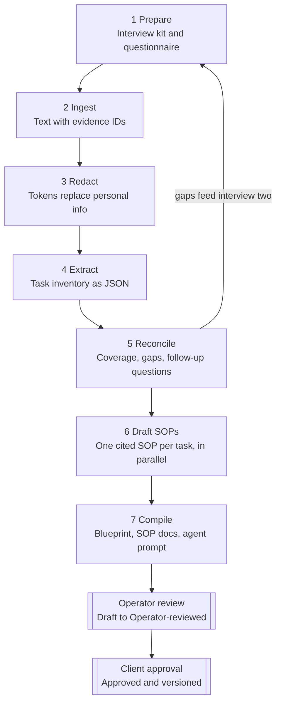

# Me² Blueprint Generator — Build Plan

Oct 22, 2026 · @Elliot Crabb

## Why I'm building this

I'm building an internal pipeline that turns a recorded intake interview plus a client's real documents into a reviewed Operational Blueprint, a written SOP for every repeat task, and a ready-to-run prompt for that client's AI drafting agent.

The hardest part of fractional back-office work is extraction. The processes live in the owner's head, and they describe them out of order, half-finished and full of exceptions. Today that knowledge gets rebuilt by hand by whoever picks up the work, and it is rebuilt differently each time.

Our promise is "every process is written down." The tool can only write down what was said or what the documents show, so the honest version is: every process we have found is written down, and the tool tells us what we haven't found yet. That second half is a feature, not a caveat: the pipeline generates the follow-up questions for the second interview.

The working rule is the same as our EA onboarding: AI drafts, the operator checks, the client signs off. Nothing becomes an approved SOP or a live agent prompt without both human steps.

## What the tool produces

Each client run produces six outputs, all generated from one structured data file per client so they never disagree with each other.

| Output | What it contains | Who uses it |
|---|---|---|
| Interview kit (before the call) | Pre-call questionnaire and a structured interview guide, tailored to the client's industry and the services they've bought | The interviewer |
| Operational Blueprint | Business overview, systems map, roles, a weekly/monthly/annual task calendar, and every task routed to AI role, operator, client-retained or automate | Me² lead, the client, and sales scoping against our two tiers |
| SOP library | One SOP per repeat task in the Me² standard (section below), every step cited to its evidence | Operators in Phnom Penh |
| Gap report and follow-up script | Tasks mentioned but not described, contradictions between what was said and what the documents show, and the questions for interview two | The interviewer |
| Client agent prompt | System prompt, voice rules, document templates and redacted examples for the client's drafting agent | The AI role and the Command Centre Operator |
| Coverage report | Share of transcript segments mapped to a task or marked out of scope, plus the count of assumed versus evidenced steps | Whoever signs the blueprint off |

The routing column in the Blueprint matters commercially: it is the scoping document for which tier the client needs, and it feeds my list of tasks a first hire can run as automations.

## How the pipeline works

I'm not doing this as one giant prompt. One pass over everything gives a confident-looking blueprint with silent gaps and invented steps. Instead it runs as seven stages, each with a narrow job and a structured output, and the gap report loops back into a second interview.



*Blueprint pipeline · 7 stages, 2 sign-offs. Gaps loop into interview two; two human sign-offs before approval.*

The loop from Reconcile back to Prepare is what keeps the promise honest: every gap becomes a question for the next interview.

1. **Prepare.** From the client profile (industry, services bought, team size), generate the pre-call questionnaire and interview guide. Better interviews are the single biggest lever on output quality.
2. **Ingest.** Load the transcript (speaker labels and timestamps required) and the documents: invoices and PDFs, exported emails, spreadsheets. Convert each to text with a stable evidence ID, e.g. `T-0412` for a transcript segment, `D-03 p2` for page 2 of a document. For spreadsheets, keep sheet names, headers and formulas, not just values: the formulas are process logic.
3. **Redact.** A deterministic pass strips bank details, card numbers, TFNs and similar first. A model pass then flags remaining third-party personal information, replaced with tokens like `[TENANT_1]`. A person confirms before anything moves on.
4. **Extract.** One call over the whole evidence bundle returns the task inventory as JSON: name, trigger, frequency, current owner, systems, inputs, outputs, evidence IDs and a confidence level.
5. **Reconcile.** A second pass maps every transcript segment to a task or marks it out of scope, merges duplicates, and lists contradictions between what was said and what the documents show. This produces the coverage report, the gap report and the follow-up questions.
6. **Draft SOPs.** One call per task, given only that task's evidence plus the cached client profile. Every step cites an evidence ID or is tagged `ASSUMED`. These calls are independent, so they run in parallel or through the Batch API.
7. **Compile.** Code, not the model, assembles the Blueprint, SOP documents and coverage report from the JSON. One extra model call builds the voice profile for the agent prompt from the email samples.

After compile, every SOP sits at **Draft**. An operator moves it to **Operator-reviewed** or sends it back with a question; the client moves it to **Approved**. When interview two adds evidence, the pipeline re-runs and shows a diff against the approved version rather than overwriting it.

## The Me² SOP standard

Every SOP has the same fields, defined once as a JSON schema that the model must fill and the renderer turns into a document. An operator who has never met the client should be able to run the task from the SOP alone.

| Field | What goes in it | Rule |
|---|---|---|
| ID and title | `APN-FIN-004 Send monthly owner statements` | Client prefix, function code, number; verb-first title |
| Trigger and frequency | What starts it, and how often | Never blank: unknown goes to the gap report |
| Owner role | AI role, operator, client, or automation | One owner; others listed as contributors |
| Systems | Every app, folder or login touched | Named exactly as the client names them |
| Inputs and outputs | What you need before starting; what exists after | Each output names where it is saved or sent |
| Steps | Numbered, one action each: actor, action, system | Each step carries an evidence ID or `ASSUMED` |
| Decision points | The if/then branches and exceptions | Pulled from "unless" and "except when" in the transcript |
| Quality check | How the operator knows it was done right | Observable, not "check carefully" |
| Escalation | When to stop and ask, and who | Always includes money, legal and complaints |
| Templates | Linked email, invoice or document templates | Redacted real examples, not invented ones |
| Time and automation score | Estimated minutes per run; score for repeatability, manual time and build effort | Same scoring I use for beachhead selection |
| Status and version | Draft, Operator-reviewed, Approved; version and date | Approved versions are never overwritten |

A step reads like this: *3. Operator — export the arrears report from the trust accounting system and save it to 03_Finance/Arrears/YYYY-MM — [T-0412, D-07].*

## The client drafting-agent prompt

The agent prompt is compiled from the approved Blueprint, not written freehand, so it changes when an SOP changes and never drifts from what the client signed off. The compiler fills a fixed template; only the voice profile is model-written.

```
# Role
You draft back-office work for {client_name} for review by a Me² operator.
You never send, pay, sign or publish anything yourself.

# The business
{one-paragraph overview, services, team and who approves what — from the Blueprint}

# Voice
{voice profile: greeting and sign-off habits, formality, words they use and avoid}
{3–5 redacted example emails from approved samples}

# What you draft
{one block per AI-owned SOP: trigger, inputs, output format, template link, quality check}

# Rules that always apply
{compliance lines, e.g. licence number on all marketing for real estate clients}
{never quote a price, date or commitment that is not in the inputs}
{never give legal, tax or financial advice}

# Stop and flag the operator when
{escalation list from the SOPs: money, complaints, legal, anything not covered above}

# Glossary
{client terms, system names, abbreviations}
```

The stable sections sit first so they can be prompt-cached across every draft for that client. The prompt carries a version number tied to the Blueprint version, so any draft can be traced back to the SOPs that shaped it.

## Data handling and compliance

Client data goes through a Commercial Claude API key under a Me² organisation, not my Max subscription. I'll use Max with Claude Code to build the tool, on sample and synthetic data only.

Three reasons:

- **Terms.** Max sits under Anthropic's Consumer Terms; the API sits under the Commercial Terms, where Anthropic acts as a data processor, prompts aren't used for training, standard retention is 30 days, and zero data retention can be arranged for eligible use. That is the position I can describe to a client.
- **Funding.** Max now includes monthly API credits ($100 on Max 5x, $200 on Max 20x) paid into one linked Console organisation, covering the Messages and Batch APIs and the Agent SDK run with an API key. So the pipeline can run on a proper API key and still be covered by the plan up to that amount. The link can't be changed without support, so I'll link the Me² org that will hold the production key. Credits don't roll over, and requests stop when they run out unless auto-reload is on.
- **Context window.** The 200k figure is no longer the ceiling for current Opus- and Sonnet-class models, but the staged design above doesn't depend on fitting everything in one window. I'll pin model IDs in config and check current limits in the docs at build time.

Engineering controls the build must include: API key in a secret store, never in the repo; each client's files isolated in their own storage prefix; Cloudflare Access in front of any web UI; an audit log of who ran, viewed and approved what; and a retention job that deletes raw audio and source documents on a set schedule.

For counsel before the first real client run:

- [ ] Call recording consent: wording read at the start of every intake call, and whether all-party consent is needed in each state we record in (South Australia first)
- [ ] Client agreement: data processing terms covering their customers' personal information that passes through Me²
- [ ] APP 8 cross-border disclosure: operators in Phnom Penh accessing Australian client data, plus processing by Anthropic
- [ ] APP 11 retention: how long we keep recordings, transcripts and source documents, and the deletion schedule
- [ ] Real estate clients: anything extra for trust account and tenancy records

## Stack and architecture

TypeScript end to end, on the Cloudflare setup I already run for the APN site, with the pipeline as a plain library so the CLI and the web app call the same code.

| Part | Choice | Why |
|---|---|---|
| Pipeline core | TypeScript package, Anthropic TypeScript SDK, Zod schemas exported to JSON Schema for structured outputs | One schema drives model output, validation and rendering |
| First runner | CLI: `blueprint run --client apn` over a local client folder | Fastest way to test on APN before any UI exists |
| Document parsing | PDF text extraction, mammoth for .docx, SheetJS for .xlsx (formulas kept), mailparser for .eml | Covers invoices, letters, spreadsheets and exported email |
| Transcripts | Accept .vtt or .txt with speaker labels and timestamps; Google Meet's transcript where our Workspace plan includes it | Transcription stays out of scope for v1 |
| Storage | R2 for files under a per-client prefix; D1 for tasks, SOPs, statuses, versions and the audit log | Already on Cloudflare; easy isolation per client |
| Long runs | Cloudflare Workflows for the multi-step pipeline, Batch API for SOP drafting | Durable retries; cheaper bulk drafting |
| Review UI | Vite and React on Cloudflare, behind Cloudflare Access | Same stack as the APN site; Phnom Penh operators log in with Workspace accounts |
| Models | Opus-class for extract, reconcile and SOP drafting; Haiku-class for redaction flagging; IDs pinned in config | Quality where it matters, cost where it doesn't |
| Exports | Markdown and PDF first; Google Docs into the client's Drive folder behind a flag | Matches how we already deliver to clients |

## Build phases for Claude Code

Five phases, each ending in something I can run and judge, so Claude Code can work through them autonomously and stop at each acceptance check.

1. **Foundations.** Repo, Zod schemas for Evidence, Task, SOP, Blueprint and AgentPrompt, and a synthetic fixture client (a fictional trades business with a fake transcript, invoices, emails and a spreadsheet). A `CLAUDE.md` with the rules from this plan.
   - Done when: the fixture validates against every schema and tests run in CI.
2. **CLI pipeline, end to end.** All seven stages on the fixture, output to Markdown and JSON.
   - Done when: every SOP step has an evidence ID or `ASSUMED`; a validator fails the run if any cited ID doesn't exist; the coverage and gap reports are produced; a second run on unchanged input produces no diff.
3. **Evals.** A golden task list I write by hand for the fixture and for one APN sample, and a script that scores task recall, citations to missing evidence, and the share of assumed steps.
   - Done when: the script runs on every prompt change and prints a comparison against the last baseline. I set pass thresholds after the first baseline, not before.
4. **Review UI.** Upload, run, SOP review with status changes and comments, diff view on re-runs, audit log, behind Cloudflare Access.
   - Done when: an operator can move an SOP from Draft to Operator-reviewed with a comment, and an Approved version can't be edited, only superseded.
5. **Exports and agent prompt.** PDF export, the compiled agent prompt with its version number, and the flagged integrations below.
   - Done when: changing an approved SOP and re-approving it bumps the agent prompt version.

Anything waiting on a decision ships behind a flag that defaults to off, so the build doesn't stall:

| Flag | Turns on | Waiting on |
|---|---|---|
| `REAL_CLIENT_DATA` | Runs on anything other than fixture data | The counsel items above being closed |
| `GOOGLE_DOCS_EXPORT` | Writing SOPs into the client's Drive folder | Drive folder convention per client |
| `CLIENT_SIGNOFF` | Client-facing approval link | Patrick's call on client access |
| `AUTO_TRANSCRIBE` | Audio upload with transcription | Choice of transcription service and its data terms |

## Pilot on APN

APN is the right first run because I already know its processes, so I can tell a missed task or an invented step at a glance, which I can't do with a new client.

- **Scope:** two functions I've already built tooling for, lease generation and outgoings reconciliation, plus one I haven't documented yet, so the test covers known and unknown ground.
- **Evidence:** a 60-minute intake interview with Patrick, the Lease Register Sheet, the outgoings trackers, and a handful of redacted tenant and owner emails.
- **What I measure:** tasks the tool found that I'd have missed, steps it invented, and time to a reviewable SOP set compared with writing them by hand.
- **Rules still apply:** APN is close to home, but its tenants' and owners' data is still client data. Consent wording, redaction and the `REAL_CLIENT_DATA` gate apply exactly as they would for a stranger.

If the APN blueprint is good enough that a new Phnom Penh operator could pick up those functions from it, the tool is ready for client two.

## Risks and open decisions for Patrick

The biggest risk isn't the build; it's an operator faithfully executing a step the model made up.

| Risk | How it shows up | What I'm doing about it |
|---|---|---|
| Invented steps | A plausible SOP step with no basis in what the client said | Mandatory evidence IDs, a validator on cited IDs, and `ASSUMED` steps shown first in review |
| Missed processes | A task that never came up in the interview | Gap report and interview two, plus a "no SOP for this" button operators use in the first 30 days |
| Judgement that doesn't transcribe | "I just know which tenants will be trouble" turns into a shallow SOP | Decision points captured explicitly; pure judgement calls routed to client-retained |
| Personal data in the agent prompt | A real customer's details in a voice example | Examples only from redacted, approved samples |
| SOPs going stale | An approved SOP nobody rereads after the client changes software | A review date on every SOP and a re-run when evidence changes |

Decisions I need from Patrick:

- [ ] Is the Blueprint a paid discovery deliverable, or bundled into onboarding for both tiers?
- [ ] Who owns the SOP library and agent prompt if a client leaves? The client agreement needs to say, and it should line up with the IP assignment in the contractor template.
- [ ] Client sign-off: a link in a portal, or a PDF approved by email?
- [ ] Who runs intake interviews after the pilot: me, or the Operations Executive hire?

## Kickoff prompt for Claude Code

Export this doc as Markdown to `docs/PLAN.md` in a new repo, then paste the prompt below into Claude Code to start Phase 1.

```
You're building the Me² Blueprint Generator. The full plan is in docs/PLAN.md — read it first.

Work one phase at a time, in order. At the end of each phase, run its "Done when" checks, show me the results, and stop for my review before starting the next phase.

Start with Phase 1 (Foundations):
- TypeScript monorepo: packages/core (pipeline library), apps/cli, apps/web (empty for now)
- Zod schemas for Evidence, Task, SOP, Blueprint and AgentPrompt, matching the SOP standard table in the plan, exported to JSON Schema
- A synthetic fixture client in fixtures/harbour-plumbing: an invented trades business with a transcript (.vtt, speaker labels and timestamps), three invoices, five emails and one spreadsheet with formulas. All fictional, no real people or businesses
- A CLAUDE.md capturing the rules below
- Tests that validate the fixture against every schema

Rules for the whole build:
- Fixture data only. Every run on other data must check the REAL_CLIENT_DATA flag, which defaults to false
- All flags in the plan default to off
- API key read from environment only; never commit secrets or client files; client folders are gitignored
- Model IDs come from config, never hard-coded in pipeline code
- Every SOP step must carry an evidence ID or ASSUMED; build the validator that enforces this in Phase 2
- Ask before adding a dependency the plan doesn't name
```

## Sources

- Use the Claude Agent SDK with your Claude plan — Claude Help Center
- Monthly API credits for Max and Team plans — Claude Help Center
- API and data retention — Claude Platform docs
- Claude Code data usage — Claude Code docs

<!-- Transcribed from the PDF export, which kept the link text but not the URLs. -->
